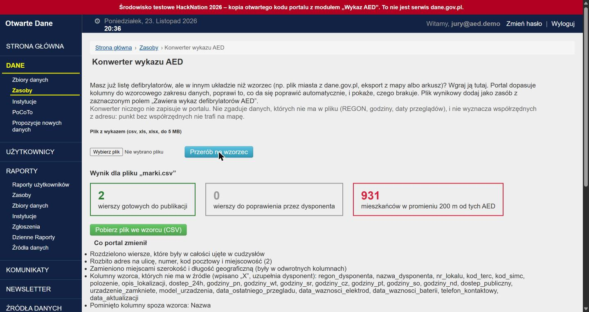
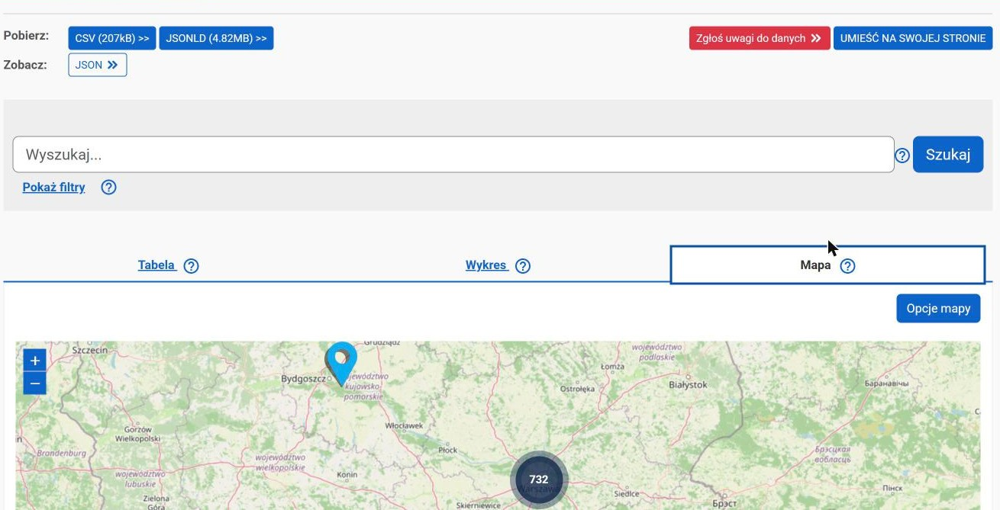
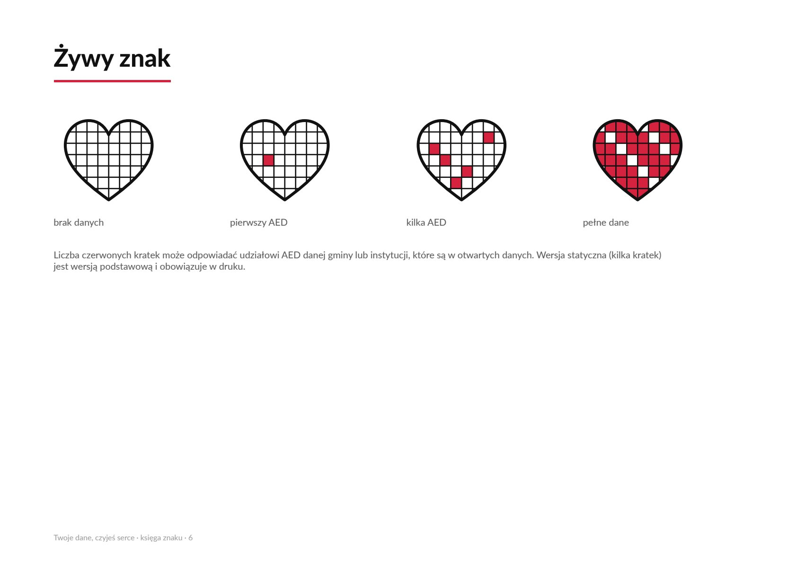
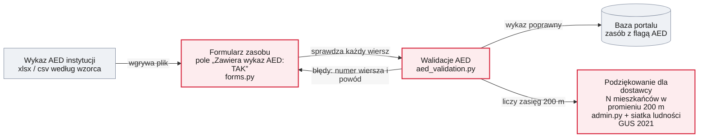
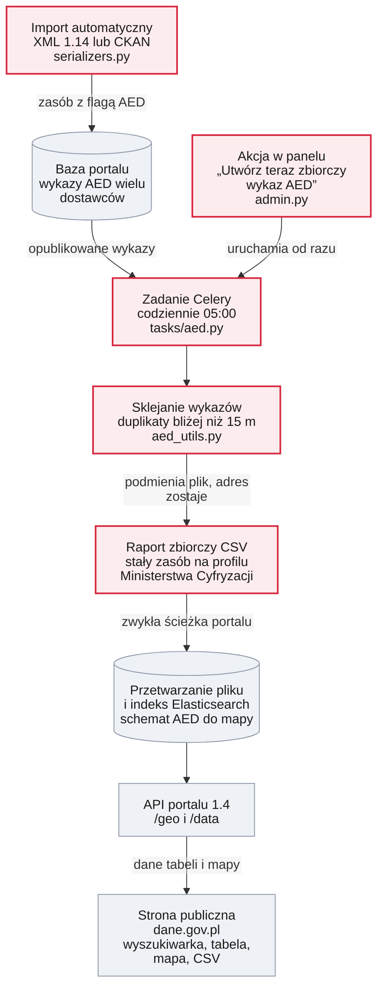

# Twoje dane, czyjeś serce

**Wykaz defibrylatorów AED wbudowany w otwarty kod portalu dane.gov.pl.** Projekt z HackNation 2026, zadanie Ministerstwa Cyfryzacji „Misja AED – Dane na ratunek”.

https://github.com/user-attachments/assets/e102be66-c088-49c4-a016-ad295362e498

▶ Film (1:20) · [YouTube](https://youtu.be/Rg7DOgKYVwk) · [plik mp4](film/Twoje_dane_czyjes_serce.mp4)

[W skrócie](#w-skrócie) · [Jak to działa](#jak-to-działa) · [Kampania](#kampania-twoje-dane-czyjeś-serce) · [Wymagania](#gdzie-sprawdzić-każde-wymaganie) · [Architektura](#architektura) · [Uruchomienie](#uruchomienie-u-siebie) · [Dla jury](DLA_JURY.md)

## W skrócie

W Polsce nie ma jednego zbioru danych o defibrylatorach. Kilka miast publikuje wykazy AED na dane.gov.pl, każde w innym układzie, a w jednym pliku współrzędne są zamienione. Ten projekt nie buduje aplikacji obok portalu, tylko rozszerza sam portal:

- **wykaz AED jako nowy rodzaj zasobu**, na wzór istniejącego w portalu wykazu danych chronionych (DGA): każda instytucja publikuje własny wykaz i odpowiada za swoje dane;
- **konwerter** przerabia plik w dowolnym układzie (np. wykaz miasta) na wzorzec i pokazuje, co poprawił;
- **walidacja każdego wiersza** przy zapisie: numer wiersza i powód błędu;
- **podziękowanie dla dostawcy** z liczbą mieszkańców, którzy dzięki niemu mają AED w promieniu 200 m;
- **codzienny raport zbiorczy** na profilu Ministerstwa Cyfryzacji: CSV, API i mapa portalu, z dostawcą, źródłem, licencją i datą dla każdego punktu;
- **wzorcowy zakres danych** (32 kolumny, xlsx) i **kampania** „Twoje dane, czyjeś serce” z logo i księgą znaku.

Demo na prawdziwych, otwartych wykazach Legionowa, Krosna, Przemyśla i Warszawy: 775 AED od 5 dostawców, ok. 509 tys. mieszkańców w promieniu 200 m.

> Serwer testowy z prototypem działał podczas HackNation (21–22.11.2026) i jest już wyłączony. Działanie pokazują film i zrzuty niżej. Całość uruchomisz u siebie w Docker Compose: [Uruchomienie u siebie](#uruchomienie-u-siebie).

## Jak to działa

**1. Dostawca publikuje wykaz jak każdy inny zasób.** Samorząd, urząd, firma, fundacja albo OSP wgrywa plik według wzorca i zaznacza nowe pole „Zawiera wykaz defibrylatorów AED: TAK”. Pole wzorowaliśmy na istniejącym w portalu wykazie chronionych danych (DGA). Za dane odpowiada instytucja, która je publikuje. Wykaz można też zasilać automatycznie importem portalu (XML 1.14 albo CKAN).

**Plik w innym układzie? Konwerter.** Większość dysponentów ma już listę AED, tylko nie we wzorcu: inne nazwy kolumn, adres w jednej komórce, współrzędne z przecinkiem albo zamienione, cały wiersz w cudzysłowie (tak wygląda wykaz Marek na dane.gov.pl). W panelu, w **Zasoby → Konwerter AED**, dostawca wgrywa taki plik, a portal dopasowuje kolumny, poprawia to, co da się poprawić, wypisuje każdą zmianę i daje plik we wzorcu do pobrania. Konwerter nie zgaduje danych, których nie ma (REGON, godziny, daty przeglądów), i nie wyznacza współrzędnych z adresu. Formularz zasobu sam podsuwa konwerter, gdy plikowi brakuje kolumn wzorca.

**2. Portal sprawdza każdy wiersz.** Jeśli plik ma błędy, formularz go nie zapisze i poda numer wiersza oraz powód, np. zamienione współrzędne, zły zapis godzin albo złą wartość TAK/NIE. Pełna lista walidacji: [DLA_JURY.md](DLA_JURY.md#walidacje-aed-mcodresourcesaed_validationpy).

**3. Dostawca dostaje podziękowanie z liczbą mieszkańców.** Po zapisaniu poprawnego wykazu panel liczy, ilu mieszkańców ma AED tego dostawcy w promieniu 200 m (siatka ludności ze spisu 2021). Tę liczbę instytucja może pokazać u siebie.

**4. Raz na dobę portal skleja wykazy w jeden zbiór.** Raport zbiorczy jest zwykłym zasobem na profilu Ministerstwa Cyfryzacji. Przy każdym punkcie jest **zakres referencyjny źródła**: dostawca, adres jego zasobu w portalu, licencja i „dane na dzień”. Portal wypełnia te kolumny sam z metadanych zasobu, więc dostawca nic nie dopisuje. Do tego „Możliwy duplikat”, „Ostrzeżenia walidacji” i gotowa mapa portalu. Administrator może go przeliczyć od razu akcją w panelu.

## Kampania „Twoje dane, czyjeś serce”

Kampania zachęca dysponentów AED do publikowania wykazów na dane.gov.pl. Znak to serce narysowane jak arkusz danych, w którym każda czerwona kratka oznacza AED, którego dane są już w portalu. Im więcej wykazów, tym bardziej czerwone serce.

- Slogan: **„Nie mów nam, gdzie jest AED. Powiedz wszystkim.”**
- Księga znaku: [`kampania/ksiega_znaku.pdf`](kampania/ksiega_znaku.pdf)
- Logo pełne, pionowe i znak mały, każde w wersji kolor, czerń i negatyw, w formatach SVG, PNG, JPG i PDF: [`kampania/`](kampania/)

## Gdzie sprawdzić każde wymaganie

| Wymaganie z treści zadania | Gdzie |
|---|---|
| „Zbierz dane z wielu rozproszonych źródeł” (pkt 2) | konwerter AED w panelu (`mcod/resources/aed_convert.py`): wykaz w dowolnym układzie → wzorzec; demo na wykazach 4 miast z dane.gov.pl |
| „…ze wskazaniem ich referencyjnego zakresu” (pkt 2) | raport zbiorczy: „Nazwa dostawcy”, „REGON dostawcy”, „Źródło danych (zasób dostawcy)”, „Licencja źródła”, „Dane źródła na dzień” (`aed_utils.describe_aed_source`) |
| „Pomóż zachęcić dysponentów do dzielenia się danymi” (pkt 2) | podziękowanie w panelu z liczbą mieszkańców w promieniu 200 m; kampania i zastosowania znaku w [`kampania/`](kampania/) |
| Integracja danych od wielu dysponentów w jednym zbiorze | `mcod/resources/aed_utils.py`, `aed_validation.py` (`build_main_aed_df`); prototyp: raport zbiorczy |
| Zgodność z zasadami działania dane.gov.pl | `git diff f90a02f` (pierwszy commit to niezmieniony kod portalu); pole w panelu, raport jako zwykły zasób, mapa portalu |
| Wzorcowy zakres danych (xlsx) | [`wzorzec/WYKAZ_AED_-_dostawca_XYZ.xlsx`](wzorzec/) (32 kolumny) i `wzorzec/opis_kolumn_wykazu_AED.xlsx` |
| Format odczytywalny maszynowo | raport zbiorczy w CSV (UTF-8) i API JSON portalu |
| Logotyp i hasło, księga znaku | [`kampania/`](kampania/) |
| Prototyp | adresy wyżej, kroki w [DLA_JURY.md](DLA_JURY.md) |
| Responsywność, WCAG | strona publiczna portalu (frontend dane.gov.pl bez zmian, z przełącznikami kontrastu i wielkości czcionki) |

Pełna tabela z krokami sprawdzenia: [DLA_JURY.md](DLA_JURY.md#gdzie-sprawdzić-każde-wymaganie-z-treści-zadania).

## Wzorcowy zakres danych

Jeden wiersz to jeden AED. Wzorzec ma 32 kolumny: identyfikator, miejsce i adres, współrzędne WGS84, położenie (wewnątrz / na zewnątrz), dostęp 24h, godziny w każdym dniu tygodnia, daty ważności elektrod i baterii. Te same kolumny są w kodzie (`mcod/resources/aed_constants.py`), a test sprawdza, że wzorzec przechodzi walidacje.

- [`wzorzec/WYKAZ_AED_-_dostawca_XYZ.xlsx`](wzorzec/WYKAZ_AED_-_dostawca_XYZ.xlsx) (też CSV)
- [`wzorzec/opis_kolumn_wykazu_AED.xlsx`](wzorzec/opis_kolumn_wykazu_AED.xlsx): opis i format każdej kolumny

## Architektura

Moduł AED nie ma własnego serwera ani bazy. Działa wewnątrz backendu dane.gov.pl i korzysta z jego mechanizmów: zasobów, walidacji plików, zadań Celery, indeksu Elasticsearch, API i mapy.

**1. Dostawca zapisuje wykaz** (w panelu, w chwili wgrania pliku)

**2. Portal skleja wykazy w raport zbiorczy** (codziennie o 05:00 albo od razu akcją w panelu)

Czerwone ramki to nasz kod. Szare ramki to to, co już istnieje: dostawcy i portal dane.gov.pl bez zmian albo z jednym wpięciem (`process_resource_file_data.py` nadaje raportowi schemat AED, żeby portal narysował mapę).

### Co zmieniliśmy w kodzie portalu

Repozytorium zawiera backend dane.gov.pl 2.63.0 (GPL v3, https://dane.gov.pl/source-code/). Pierwszy commit `f90a02f` to kod portalu bez zmian. Wszystkie nasze zmiany są w kolejnych commitach (`git diff f90a02f`).

| Plik | Co robi |
|---|---|
| `mcod/resources/models.py`, `migrations/0076_…` | pole „wykaz AED” w zasobie, obok pola DGA |
| `mcod/resources/forms.py`, `admin.py` | walidacja przy zapisie, podziękowanie z liczbą mieszkańców, akcja „Utwórz teraz zbiorczy wykaz” |
| `mcod/resources/aed_validation.py` | walidacje wierszy, sklejanie wykazów, wykrywanie duplikatów, liczenie mieszkańców w promieniu 200 m |
| `mcod/resources/aed_convert.py`, `aed_converter_view.py`, `templates/admin/resources/aed_converter.html` | konwerter: plik w dowolnym układzie → wzorzec, z listą zmian, walidacją i podglądem |
| `mcod/resources/aed_utils.py`, `tasks/aed.py`, `celeryapp.py` | codzienne zadanie o 05:00, które podmienia plik w stałym zasobie raportu |
| `mcod/resources/aed_constants.py` | kolumny wzorca i słowniki wartości |
| `mcod/harvester/serializers.py`, `data/harvester/xml_import_otwarte_dane_1_14.xsd` | import automatyczny: schemat XML 1.14 z `containsAedList` i pole CKAN `contains_aed_list`, na wzór `containsProtectedData` (DGA) |
| `translations/…/django.po` | komunikaty po polsku, przez tłumaczenia portalu |
| `mcod/settings/aed_demo.py`, `aed_demo_login.py` | tylko demo: ustawienia serwera testowego i wejście jury jednym kliknięciem |

**Testy:** 182 testy modułu AED (wzorzec, pliki z Excela i CSV w różnych kodowaniach, wartości skrajne, raport z 20 000 AED, import XML i CKAN, konwerter na fragmentach prawdziwych wykazów Marek i Krosna, zakres referencyjny w raporcie). Polecenie: [DLA_JURY.md](DLA_JURY.md#testy).
**Użycie AI, dane demo i ograniczenia:** [DLA_JURY.md](DLA_JURY.md#użycie-sztucznej-inteligencji).

## Uruchomienie u siebie

- Prototyp AED w Docker Compose (porty tylko na 127.0.0.1): [`demo_aed/README.md`](demo_aed/README.md)
- Oryginalna instrukcja środowiska deweloperskiego portalu: [README_PORTAL.md](README_PORTAL.md)
- Konwerter po uruchomieniu: http://127.0.0.1:8001/resources/resource/aed-konwerter/

## Po HackNation

Wersja oddana jury o 11:00 22.11.2026 jest w historii repozytorium (commit `167e1eb`). Po konkursie, 23.11.2026, dołożyliśmy dwie rzeczy, które mieliśmy już we wcześniejszym repozytorium roboczym, ale nie przenieśliśmy do portalu przed terminem:

- **konwerter AED** (z funkcji `napraw` z pierwszej wersji projektu, przepisany na 32 kolumny wzorca i wpięty w panel);
- **zakres referencyjny źródła** w raporcie zbiorczym (źródło, licencja, dane na dzień).

Licencja: kod portalu i nasze zmiany są na GPL v3, jak backend dane.gov.pl.
