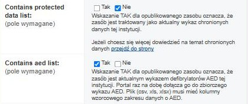
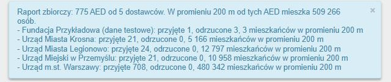
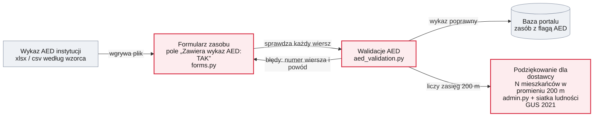
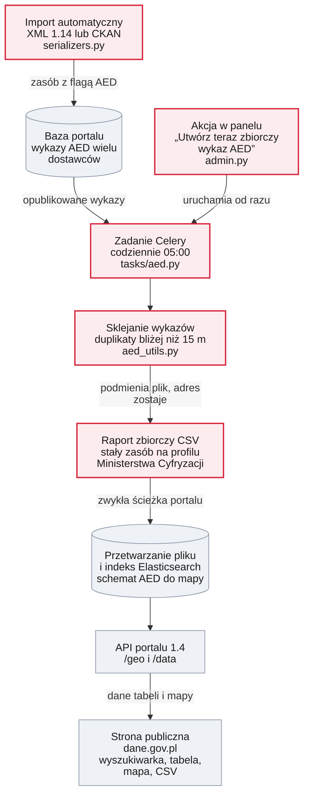

# Twoje dane, czyjeś serce

**HackNation 2026 · Misja AED (Ministerstwo Cyfryzacji)**

<!-- FILM: wgraj .mp4 przeciągając go do edytora README na github.com (do 10 MB),
     a adres https://github.com/user-attachments/assets/... wklej w osobnej linii zamiast obrazka niżej. -->

*Film jest w przygotowaniu.*

[Prototyp](#wypróbuj-prototyp) · [Jak to działa](#jak-to-działa) · [Kampania](#kampania-twoje-dane-czyjeś-serce) · [Wymagania](#gdzie-sprawdzić-każde-wymaganie) · [Architektura](#architektura) · [Dla jury](DLA_JURY.md)

## Wypróbuj prototyp

### 👉 **https://portal.145-239-30-81.sslip.io/aed**

Zbiór „Wykaz defibrylatorów AED – raport zbiorczy” na stronie publicznej portalu. Wchodzisz bez logowania. Przewiń do zakładki **Mapa**: jest na niej 775 AED od 5 dostawców.

| Co | Adres |
|---|---|
| Wyszukiwarka portalu | https://portal.145-239-30-81.sslip.io/pl/search?q=defibrylator |
| Panel administracyjny z modułem AED | https://admin.145-239-30-81.sslip.io (link „wejście jednym kliknięciem” i konto zapasowe są w zgłoszeniu HackTribe) |
| API: punkty mapy | https://api.145-239-30-81.sslip.io/1.4/resources/8/geo |
| API: wiersze z wyszukiwaniem | https://api.145-239-30-81.sslip.io/1.4/resources/8/data?q=Krosno |

To środowisko testowe (oznacza je czerwony pasek u góry każdej strony), nie serwis dane.gov.pl. **Kroki dla jury (ok. 5 min): [DLA_JURY.md](DLA_JURY.md#kroki-dla-jury-ok-5-minut).**

## Jak to działa

**1. Dostawca publikuje wykaz jak każdy inny zasób.** Samorząd, urząd, firma, fundacja albo OSP wgrywa plik według wzorca i zaznacza nowe pole „Zawiera wykaz defibrylatorów AED: TAK”. Pole wzorowaliśmy na istniejącym w portalu wykazie chronionych danych (DGA). Za dane odpowiada instytucja, która je publikuje. Wykaz można też zasilać automatycznie importem portalu (XML 1.14 albo CKAN).

**2. Portal sprawdza każdy wiersz.** Jeśli plik ma błędy, formularz go nie zapisze i poda numer wiersza oraz powód, np. zamienione współrzędne, zły zapis godzin albo złą wartość TAK/NIE. Pełna lista walidacji: [DLA_JURY.md](DLA_JURY.md#walidacje-aed-mcodresourcesaed_validationpy).

**3. Dostawca dostaje podziękowanie z liczbą mieszkańców.** Po zapisaniu poprawnego wykazu panel liczy, ilu mieszkańców ma AED tego dostawcy w promieniu 200 m (siatka ludności ze spisu 2021). Tę liczbę instytucja może pokazać u siebie.

**4. Raz na dobę portal skleja wykazy w jeden zbiór.** Raport zbiorczy jest zwykłym zasobem na profilu Ministerstwa Cyfryzacji. Ma kolumny „Nazwa dostawcy”, „Możliwy duplikat” i „Ostrzeżenia walidacji” oraz gotową mapę portalu. Administrator może go przeliczyć od razu akcją w panelu.

## Kampania „Twoje dane, czyjeś serce”

Kampania zachęca dysponentów AED do publikowania wykazów na dane.gov.pl. Znak to serce narysowane jak arkusz danych, w którym każda czerwona kratka oznacza AED, którego dane są już w portalu. Im więcej wykazów, tym bardziej czerwone serce.

- Slogan: **„Nie mów nam, gdzie jest AED. Powiedz wszystkim.”**
- Księga znaku: [`kampania/ksiega_znaku.pdf`](kampania/ksiega_znaku.pdf)
- Logo pełne, pionowe i znak mały, każde w wersji kolor, czerń i negatyw, w formatach SVG, PNG, JPG i PDF: [`kampania/`](kampania/)

## Gdzie sprawdzić każde wymaganie

| Wymaganie z treści zadania | Gdzie |
|---|---|
| Integracja danych od wielu dysponentów w jednym zbiorze | `mcod/resources/aed_utils.py`, `aed_validation.py` (`build_main_aed_df`); prototyp: raport zbiorczy |
| Zgodność z zasadami działania dane.gov.pl | `git diff f90a02f` (pierwszy commit to niezmieniony kod portalu); pole w panelu, raport jako zwykły zasób, mapa portalu |
| Wzorcowy zakres danych (xlsx) | [`wzorzec/WYKAZ_AED_-_dostawca_XYZ.xlsx`](wzorzec/) (32 kolumny) i `wzorzec/opis_kolumn_wykazu_AED.xlsx` |
| Format odczytywalny maszynowo | raport zbiorczy w CSV (UTF-8) i API JSON portalu |
| Logotyp i hasło, księga znaku | [`kampania/`](kampania/) |
| Prototyp | adresy wyżej, kroki w [DLA_JURY.md](DLA_JURY.md) |
| Responsywność, WCAG | strona publiczna portalu (frontend dane.gov.pl bez zmian, z przełącznikami kontrastu i wielkości czcionki) |

Pełna tabela z krokami sprawdzenia: [DLA_JURY.md](DLA_JURY.md#gdzie-sprawdzić-każde-wymaganie-z-treści-zadania).

## Wzorcowy zakres danych

Jeden wiersz to jeden AED. Wzorzec ma 32 kolumny: identyfikator, miejsce i adres, współrzędne WGS84, położenie (wewnątrz / na zewnątrz), dostęp 24h, godziny w każdym dniu tygodnia, daty ważności elektrod i baterii. Te same kolumny są w kodzie (`mcod/resources/aed_constants.py`), a test sprawdza, że wzorzec przechodzi walidacje.

- [`wzorzec/WYKAZ_AED_-_dostawca_XYZ.xlsx`](wzorzec/WYKAZ_AED_-_dostawca_XYZ.xlsx) (też CSV)
- [`wzorzec/opis_kolumn_wykazu_AED.xlsx`](wzorzec/opis_kolumn_wykazu_AED.xlsx): opis i format każdej kolumny

## Architektura

Moduł AED nie ma własnego serwera ani bazy. Działa wewnątrz backendu dane.gov.pl i korzysta z jego mechanizmów: zasobów, walidacji plików, zadań Celery, indeksu Elasticsearch, API i mapy.

**1. Dostawca zapisuje wykaz** (w panelu, w chwili wgrania pliku)

**2. Portal skleja wykazy w raport zbiorczy** (codziennie o 05:00 albo od razu akcją w panelu)

Czerwone ramki to nasz kod. Szare ramki to to, co już istnieje: dostawcy i portal dane.gov.pl bez zmian albo z jednym wpięciem (`process_resource_file_data.py` nadaje raportowi schemat AED, żeby portal narysował mapę).

### Co zmieniliśmy w kodzie portalu

Repozytorium zawiera backend dane.gov.pl 2.63.0 (GPL v3, https://dane.gov.pl/source-code/). Pierwszy commit `f90a02f` to kod portalu bez zmian. Wszystkie nasze zmiany są w kolejnych commitach (`git diff f90a02f`).

| Plik | Co robi |
|---|---|
| `mcod/resources/models.py`, `migrations/0076_…` | pole „wykaz AED” w zasobie, obok pola DGA |
| `mcod/resources/forms.py`, `admin.py` | walidacja przy zapisie, podziękowanie z liczbą mieszkańców, akcja „Utwórz teraz zbiorczy wykaz” |
| `mcod/resources/aed_validation.py` | walidacje wierszy, sklejanie wykazów, wykrywanie duplikatów, liczenie mieszkańców w promieniu 200 m |
| `mcod/resources/aed_utils.py`, `tasks/aed.py`, `celeryapp.py` | codzienne zadanie o 05:00, które podmienia plik w stałym zasobie raportu |
| `mcod/resources/aed_constants.py` | kolumny wzorca i słowniki wartości |
| `mcod/harvester/serializers.py`, `data/harvester/xml_import_otwarte_dane_1_14.xsd` | import automatyczny: schemat XML 1.14 z `containsAedList` i pole CKAN `contains_aed_list`, na wzór `containsProtectedData` (DGA) |
| `translations/…/django.po` | komunikaty po polsku, przez tłumaczenia portalu |
| `mcod/settings/aed_demo.py`, `aed_demo_login.py` | tylko demo: ustawienia serwera testowego i wejście jury jednym kliknięciem |

**Testy:** 163 testy modułu AED (wzorzec, pliki z Excela i CSV w różnych kodowaniach, wartości skrajne, raport z 20 000 AED, import XML i CKAN). Polecenie: [DLA_JURY.md](DLA_JURY.md#testy).
**Użycie AI, dane demo i ograniczenia:** [DLA_JURY.md](DLA_JURY.md#użycie-sztucznej-inteligencji).

## Uruchomienie u siebie

- Prototyp AED w Docker Compose (porty tylko na 127.0.0.1): [`demo_aed/README.md`](demo_aed/README.md)
- Oryginalna instrukcja środowiska deweloperskiego portalu: [README_PORTAL.md](README_PORTAL.md)
